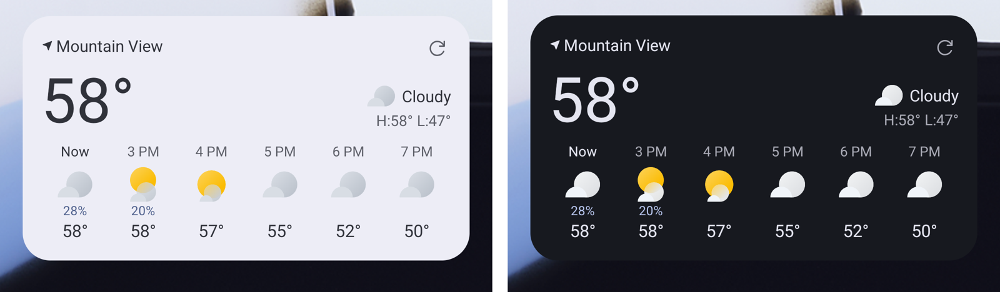

# Help Me Weather

**The weather widget Pixel should have shipped with.**

The stock Pixel weather options are a one-line At a Glance and a widget you can barely customize. iOS and One UI have had proper weather widgets for years, with the temperature up front and a clean hourly row. Help Me Weather brings that layout to Pixel and builds it the Pixel way: Material 3, your wallpaper colors, Google's own weather icons, and Google's forecast, so the widget agrees with Pixel Weather and At a Glance.

<p align="center">
  
</p>

> **It's just a widget.** No notifications (the permission is removed from the manifest), no ads, no analytics, no accounts. Location is optional.

## Download

**[⬇ Download Help Me Weather 0.1.1 (APK)](https://github.com/artemulianko/help-me-weather/releases/download/v0.1.1/help-me-weather-0.1.1.apk)** · Android 12+ · 4.4 MB · [release notes](https://github.com/artemulianko/help-me-weather/releases/tag/v0.1.1)

SHA-256 `5d22f3de75b3a66e409e520c3a578b7716ec3ff186028039f77833f48e8747d1`

1. Download the APK on your phone and open it (allow "Install unknown apps" for your browser when asked).
2. Open **Help Me Weather** once and allow approximate location, or skip that and pick a city.
3. Long-press the home screen → **Widgets** → **Help Me Weather** → drag it out. Long-press the widget → **Customize** to change it.

## Why it fits a Pixel

| | |
|---|---|
| **Same forecast as your Pixel** | With a Google Maps Platform key (see [below](#use-googles-forecast-same-as-pixel-weather)) the data comes from Google's weather service, the backend behind Pixel Weather and At a Glance, so you see the same temperatures and conditions everywhere. Without a key it uses [Open-Meteo](https://open-meteo.com) (free, open data) automatically. |
| **Google's weather icons** | The exact icon set Pixel Weather uses, including night variants, with dark-mode art that switches with the system theme. A monochrome Material Symbols set that follows your accent color is also available. |
| **Matches your theme** | Material You colors come straight from the system's color resources, so the widget follows your wallpaper and light/dark mode immediately, even with a transparent background. |
| **Material 3, by the guidelines** | Follows Android's canonical widget specs: 16dp padding, system corner radius, 48dp touch targets, Google Sans on Pixel, and edge-to-edge fill at every size. |
| **Tap opens Pixel Weather** | Tapping the widget opens Google's weather (the Pixel Weather app or the Google app's weather page). You can change it to open this app, refresh, or do nothing. |

## Every size, laid out properly

The layout adapts to the real cell size the launcher reports, from 1×1 up to 4×4, plus landscape and foldables. All of these are pre-rendered, so resizing or rotating never wakes the app.

<p align="center"></p>

## Battery

Designed to be invisible in your battery stats. Measured on an Android 17 emulator:

| What | Cost |
|---|---|
| Background refresh (hourly by default) | ~1.5 s job, ~0.5 s CPU, ~7 KB of data |
| Rendering the widget | ~100 ms, one-shot |
| Between refreshes | Nothing: no alarms, no services, no wakelocks, no listeners |

How:

- **WorkManager only.** Android batches refreshes with other apps' jobs, respects Doze and App Standby, waits for a network, and **skips background refreshes on low battery**. Manual refresh always works.
- **No Glance sessions.** Jetpack Glance normally keeps a background job (and a wakelock) alive for about 45 s after every widget update. Help Me Weather renders straight to RemoteViews instead, so each update is a single short render.
- **Location without GPS.** Approximate (cell/Wi‑Fi) location only, reusing Android's cached fix when it's recent. No location listener ever stays registered.
- **Fetches only what's shown.** One request set per location, cached and shared by every widget; nothing is downloaded while the data is still fresh.
- **No notifications, no foreground service.** WorkManager's foreground-service path is stripped from the manifest.

## Privacy

- Location is optional and approximate. Coordinates are **rounded to about 1 km** before they're stored, turned into a city name, or sent to a weather provider.
- No analytics, crash reporting, ads or accounts. Settings (including your API key) stay on the device and are excluded from backups and device transfers.
- Network requests go to the weather provider you choose (Google or Open-Meteo), to Open-Meteo as an automatic fallback when Google fails, and to Open-Meteo's geocoding when you search for a city. The city name for your location comes from Android's system geocoder, which may use Google's servers.
- The in-app **Logs** (last 3 days) stay on the phone; API keys are redacted from them.

## Use Google's forecast (same as Pixel Weather)

Google only offers its weather data to other apps through the [Google Maps Platform Weather API](https://developers.google.com/maps/documentation/weather/overview), which needs your own API key. Typical personal use should stay within the free monthly usage, but check Google's current pricing before you rely on that.

1. Open the [Google Cloud Console](https://console.cloud.google.com/) and create a project (a billing account is required, even for free usage).
2. Enable the **Weather API** in **APIs & Services → Library**.
3. Create a key in **APIs & Services → Credentials → Create credentials → API key**.
4. **Restrict the key** (recommended), to limit what a leaked key could do:
   - *API restrictions*: Weather API only.
   - *Application restrictions → Android apps*: package `app.helpmeweather`, SHA-1 `F1:85:1D:9D:C0:E3:01:FB:77:F9:81:66:11:B9:81:2D:21:59:9B:32` (the release signing certificate; the app sends these on every request). This stops casual reuse, but these values are public, so a determined person who extracts your key could still send them; also set a daily quota on the key.
5. In Help Me Weather, go to **Forecast source → Google**, paste the key, and tap **Save**.

The key is stored only on your phone and is excluded from backups and device transfers. If Google is unreachable or the key is wrong, Help Me Weather falls back to Open-Meteo (sending it the same rounded coordinates), so the widget never goes blank.

## Build from source

Requirements: JDK 21, Android SDK with platform 37, and an emulator or device running Android 12 or later.

```bash
./gradlew assembleDebug                 # debug APK
./gradlew assembleRelease               # minified release → releases/help-me-weather-<version>.apk (needs keystore/; add -PallowDebugSigning=true for a local test build)
./gradlew testDebugUnitTest             # parsing and mapping unit tests
./gradlew connectedDebugAndroidTest     # on-device: live network, every widget size and config rendered, UI flow
```

`WidgetRenderTest` renders the real widget at every size and in a matrix of configurations and saves PNGs to `/sdcard/Android/data/app.helpmeweather/files/renders`.

To regenerate the icons (downloaded from Google and converted with Android's own SVG converter), run `python3 tools/import_icons.py`. To regenerate the dynamic color resources, run `python3 tools/gen_colors.py`.

### Project layout

```
app/src/main/java/app/helpmeweather/
  data/     providers (Google, Open-Meteo), settings + cache (DataStore), location, formatting
  widget/   Glance layouts, colors, session-free renderer, receivers
  work/     WorkManager refresh scheduling
  ui/       Compose (Material 3 Expressive) app + per-widget editor
tools/      icon import, color generation, svg2vector
```

Built with Kotlin, Jetpack Glance, Compose Material 3, WorkManager and DataStore. No Retrofit, OkHttp or image libraries.

## Credits

- Weather icons © Google, from Google's weather icon set (`maps.gstatic.com/weather`). Light-theme variants have slightly deepened cloud greys for contrast on light widget backgrounds.
- [Material Symbols](https://fonts.google.com/icons) © Google, Apache License 2.0.
- Fallback weather data and geocoding by [Open-Meteo.com](https://open-meteo.com), CC BY 4.0.
- Not affiliated with Google. Pixel, Pixel Weather and Google are trademarks of Google LLC.

## License

Code: [MIT](LICENSE). Third-party assets are under their own terms (see Credits).
