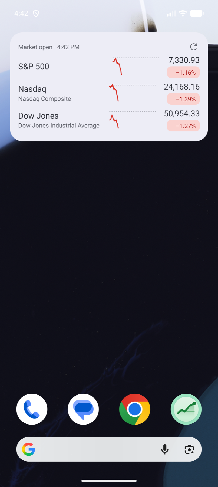
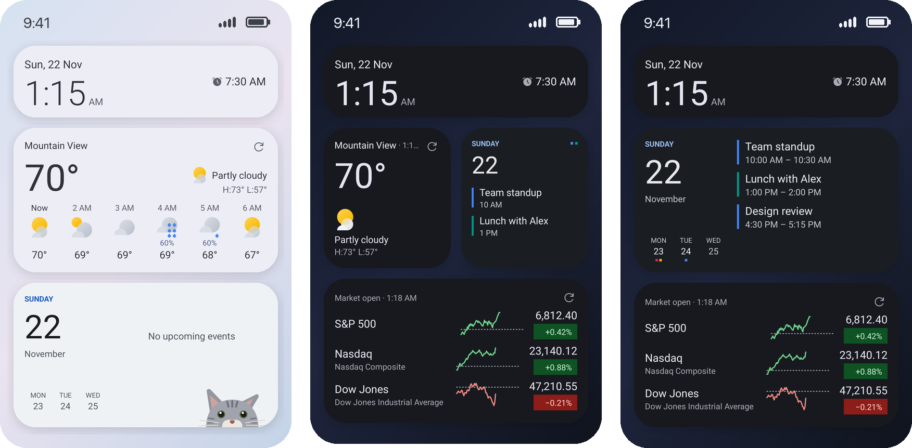

# Help Me Widgets

**The home screen widgets Pixel should have shipped with.**

<p align="center">
  
</p>

## Why this exists

Android invented home screen widgets, yet a stock Pixel still has very few good-looking ones. You get a one-line At a Glance, a weather widget you can barely customize, and no stocks widget at all. iPhone and Samsung's One UI have had calm, well-designed widgets for years, with the big number up front, a clean row of detail below, and a layout that looks deliberate at every size.

So we built the widgets we wanted on our own Pixel. They take the layouts people like on iOS and One UI and build them the Pixel way: Material 3, your wallpaper colors, Google Sans, the system corner radius, light and dark mode. Each widget has its own small app, and that app exists only to set the widget up.

This whole repository is vibe-coded: designed, built, tested and reviewed in conversations with AI coding agents, against the strict rules in [AGENTS.md](AGENTS.md). The rules are the product. They're why the widgets stay small, fast, private and consistent.

## The widgets

| | Widget | What it shows | Download |
|---|---|---|---|
| ☀️ | [**Help Me Weather**](help-me-weather/) | Temperature up front and a clean hourly or daily row, with Google's forecast and Google's weather icons, so it agrees with Pixel Weather and At a Glance. | **[⬇ APK 1.0.7](https://github.com/artemulianko/help-me-widgets/releases/download/weather-v1.0.7/help-me-weather-1.0.7.apk)** · 4.2 MB |
| 🕒 | [**Help Me Clock**](help-me-clock/) | A calm digital clock in the same style as its siblings: date and time on the left, your next alarm on the right, in one 4×1 row. Or turn the time off for date + alarm. No internet permission. | **[⬇ APK 1.0.6](https://github.com/artemulianko/help-me-widgets/releases/download/clock-v1.0.6/help-me-clock-1.0.6.apk)** · 3.4 MB |
| 📈 | [**Help Me Stocks**](help-me-stocks/) | Your watchlist with the day's chart, price and change at a glance, like the iPhone Stocks widget. Market-hours aware. | **[⬇ APK 1.0.7](https://github.com/artemulianko/help-me-widgets/releases/download/stocks-v1.0.7/help-me-stocks-1.0.7.apk)** · 3.9 MB |
| 📅 | [**Help Me Calendar**](help-me-calendar/) | Today's date rail with calendar-color event dots, mini month grid and upcoming agenda, with per-widget calendar filtering. Reads only Android's local calendar store and never sends anything to the internet. | **[⬇ APK 0.1.5](https://github.com/artemulianko/help-me-widgets/releases/download/calendar-v0.1.5/help-me-calendar-0.1.5.apk)** · 3.6 MB |

They need Android 12 or later and are tuned on a Pixel 11 Pro running Android 17. Open the APK on your phone (allow "Install unknown apps" when asked), open the app once, then long-press the home screen → **Widgets**. Each widget's README has install details, SHA-256 checksums and release notes. All versions are on the [Releases](https://github.com/artemulianko/help-me-widgets/releases) page.

## Layout ideas

Mix and match sizes on a clean home screen page — all four widgets share the same typography, corner radius, palettes and opacity controls.

<p align="center">
  
</p>

## Philosophy

- **Widget first.** These aren't apps that happen to have a widget. Each widget's app is a settings screen: a live preview, an editor and in-app logs. That's all.
- **No ads, no tracking, no accounts.** No analytics, no crash reporting, no notifications you ever see (the permission is removed from the manifest; the refresh button's short foreground service needs one, and Android never shows it). Your settings never leave the phone and are excluded from backups.
- **Minimal functionality.** Each widget does one job well. Every feature has to earn its place on a home screen, and when something is in doubt we remove it.
- **Clean design.** Material 3 by the guidelines, with layouts inspired by iOS and One UI. Nothing scrolls inside a widget, and every size from 1×1 to 4×4 has its own layout.
- **Invisible in battery stats.** No alarms, services, wakelocks or listeners. A refresh is one short WorkManager job, and the widget is drawn once per update with no Glance session left running.
- **One family.** Every widget has the same editor, the same color, theme and opacity controls, and the same logs, so they look like they belong together on one home screen.

## Repository layout

Each widget is a **standalone Android project** with its own Gradle wrapper, version, signing, releases and license. They share rules and conventions, not code.

```
help-me-widgets/
  AGENTS.md            rules for every contributor (human or AI): philosophy, design, tests, release
  CLAUDE.md            Claude Code entry point (imports AGENTS.md)
  .claude/             skills, agents and scoped rules for AI coding sessions
  docs/                design system, testing guide, shared screenshots
  help-me-weather/     Help Me Weather (see its README)
  help-me-stocks/      Help Me Stocks (see its README)
  help-me-clock/       Help Me Clock (see its README)
  help-me-calendar/    Help Me Calendar (see its README)
```

## Build

Requirements: JDK 21, the Android SDK with platform 37, and an Android 12+ device or emulator.

```bash
cd help-me-weather && ./gradlew assembleDebug testDebugUnitTest
```

```bash
cd help-me-stocks && ./gradlew assembleDebug testDebugUnitTest
```

```bash
cd help-me-clock && ./gradlew assembleDebug testDebugUnitTest
```

```bash
cd help-me-calendar && ./gradlew assembleDebug testDebugUnitTest
```

On-device tests, release builds and the end-to-end flow are covered in [docs/testing.md](docs/testing.md).

## Contributing

Read [AGENTS.md](AGENTS.md) first. It's short, it's strict, and it applies to people and AI agents alike. The design rules are in [docs/design.md](docs/design.md).

## License

Code is [MIT](help-me-weather/LICENSE). Third-party assets (Google weather icons, Material Symbols, data providers) are under their own terms; see each widget's README.

Not affiliated with Google, Apple, Samsung or Yahoo. Pixel and Google are trademarks of Google LLC.
