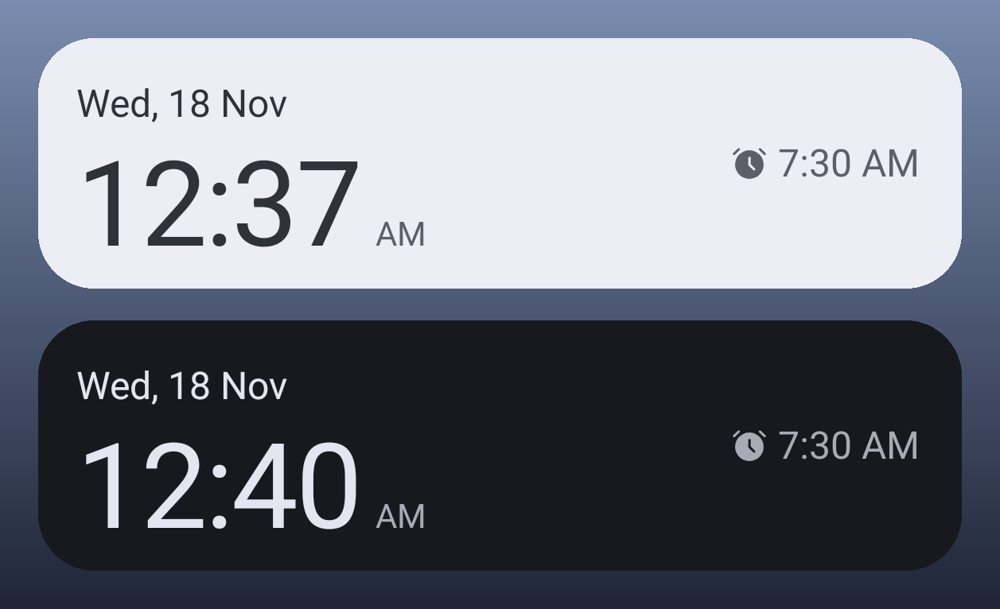
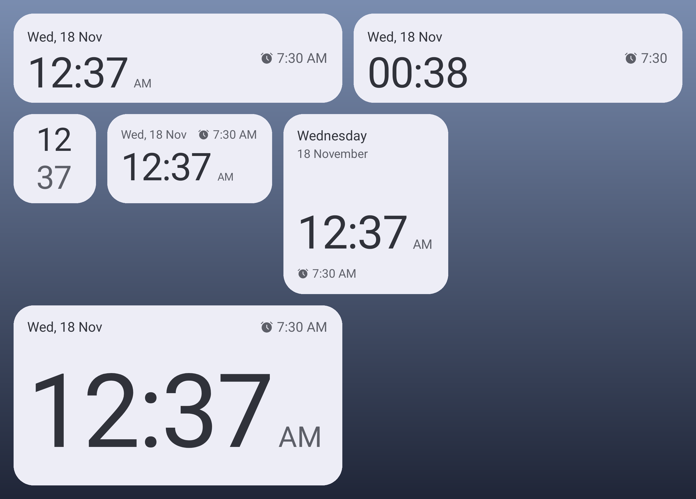
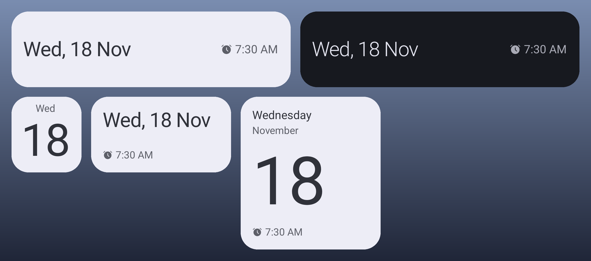
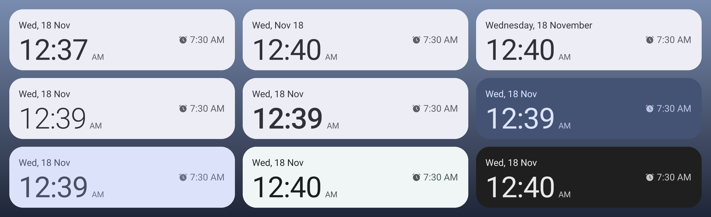

# Help Me Clock

**A calm digital clock that matches the rest of your widgets: date, time and your next alarm in one row.**

*Part of [Help Me Widgets](../README.md), together with [Help Me Weather](../help-me-weather/) and [Help Me Stocks](../help-me-stocks/).*

Pixel's clock widgets each have their own look and squeeze the date and alarm into a tiny line. Help Me Clock is a clean digital clock with the same design, colors and margins as Help Me Weather and Help Me Stocks, so they look like one set side by side. By default it's a 4×1 row: the date over the time on the left, your next alarm on the right, nothing truncated, laid out like iOS and One UI widgets and built the Pixel way: Material 3, your wallpaper colors, and the same design and customization as its siblings.

<p align="center">
  
</p>

> **It's just a widget.** No accounts, no ads, no analytics, no notifications (the permission is removed from the manifest), and **no internet permission at all**: nothing can leave your phone. Tap the time to open your clock app, tap the alarm to open that alarm.

## Download

**[⬇ Download Help Me Clock 1.0.4 (APK)](https://github.com/artemulianko/help-me-widgets/releases/download/clock-v1.0.4/help-me-clock-1.0.4.apk)** · Android 12+ · 3.2 MB · [release notes](https://github.com/artemulianko/help-me-widgets/releases/tag/clock-v1.0.4) · [all releases](https://github.com/artemulianko/help-me-widgets/releases)

SHA-256 `64fb82e38d21a30a5aeabcd52707fcecd7b8e2187b44491bb3842d0ded625893`

1. Download the APK on your phone and open it (allow "Install unknown apps" for your browser when asked).
2. Open **Help Me Clock** once.
3. Tap **Add to home screen** (it lands as a 4×1 row), or long-press the home screen → **Widgets** → **Help Me Clock**. Long-press the widget → **Customize** to change it.

## Why it fits a Pixel

| | |
|---|---|
| **Your next alarm, always** | The alarm from your clock app (Google Clock, Samsung Clock…) sits at the end of the row: "7:30 AM" when it rings within a day, "Thu 7:30 AM" when later. No alarm, no clutter. Tap it to open that alarm. |
| **A date you can read** | Pick **Tue, 17 Nov**, **Tue, Nov 17** or **Tuesday, 17 November** (names in your language). The format you pick is always shown in full: every size checks the longest weekday and month (and the widest alarm) first and makes the text smaller rather than cutting it or switching to a shorter format. |
| **Time already in the status bar?** | Turn **Time** off and the date takes the lead (weekday large, month and day under it) with the alarm beside it. |
| **Ticks for free** | The time is a system `TextClock` drawn by your launcher, so the widget never wakes the app to tick, and the date turns over at midnight on its own. |
| **Matches your theme** | Material You colors come straight from the system's color resources, so the widget follows your wallpaper and light/dark mode immediately, even with a transparent background. Seven fixed palettes too. |
| **Same customization as its siblings** | Palette, theme, background tone, opacity, numeral weight (Light, Regular, Medium), main and secondary text size (Smaller, Default, Larger: the time or big date, and the small date and alarm), what to show, and what a tap does: identical controls, live preview, every size. |
| **Material 3, by the guidelines** | 16 dp padding, the system corner radius, Google Sans on Pixel, tabular digits so the time never shifts sideways, AM/PM small on the baseline, 12/24-hour from your system setting. |

## Every size, laid out properly

4×1 is the default; every size from 1×1 (hours over minutes) up to 4×4, plus landscape, has its own layout. Text is measured and fitted to each size, so "12:58 PM" fits as well as "9:41", and it holds up on every launcher grid (Small to XL), display size and font size (font scaling is honored up to 1.15× so nothing overflows and the time stays the biggest thing).

<p align="center"></p>

With **Time** off, the date leads:

<p align="center"></p>

<p align="center"></p>

## Battery

Probably the cheapest widget on your home screen.

| What | Cost |
|---|---|
| Ticking every minute | **Nothing**: the launcher's TextClock does it |
| The date at midnight | Nothing: TextClock again |
| An alarm added, changed or removed | One short Glance render job, when Android says the next alarm changed |
| Time zone, 12/24-hour or language change | One short render |
| Network | **None**: there's no internet permission |
| Everything else | Nothing: no alarms, services or listeners. Glance's render job (WorkManager) runs only when the widget is redrawn, for a few seconds. |

## Privacy

- No accounts, analytics, crash reporting or ads. No internet, location or other user-facing permissions; besides `RECEIVE_BOOT_COMPLETED`, the manifest has only the wake-lock and network-state permissions WorkManager needs to run Glance's render jobs.
- The widget reads only the time of your next alarm from Android (and which app set it, so it can show only your clock app's alarms).
- Settings stay on the phone and are excluded from backups and device transfers.
- The in-app **Logs** (last 3 days) stay on the phone.

## How the alarm works

The widget shows your **next** alarm only: Android tells apps about the earliest upcoming alarm and nothing after it (the rest live inside your clock app). Android reports that single earliest "alarm clock" from any app. Sleep trackers and calendars can set those too. Help Me Clock shows it only when it comes from your clock app. If another app's alarm is earlier, the widget shows no alarm rather than the wrong one, and the Logs say so ("set by …, not the clock app (hidden)"). It reappears once that alarm has passed.

If you rarely open the app, turn off Android's **Pause app activity if unused** (the app offers a shortcut). Otherwise Android can stop the widget from hearing about alarm changes after a few months.

## Build from source

Requirements: JDK 21, Android SDK with platform 37, and an emulator or device running Android 12 or later.

```bash
./gradlew assembleDebug                 # debug APK
./gradlew assembleRelease               # minified release → releases/help-me-clock-<version>.apk (needs keystore/; add -PallowDebugSigning=true for a local test build)
./gradlew testDebugUnitTest             # alarm label and log unit tests
./gradlew connectedDebugAndroidTest     # on-device: every size and configuration rendered, end-to-end flows
```

`WidgetRenderTest` renders the real widget at every size, in 12- and 24-hour mode and a matrix of configurations, checks that no text is clipped, and saves PNGs to `/sdcard/Android/data/app.helpmeclock/files/renders` (run it with `adb shell am instrument` to keep them, since Gradle uninstalls the app afterwards). `WidgetFlowTest` pins the widget through the real launcher dialog, sets an alarm in the clock app and taps the widget.

To regenerate the icons (Material Symbols, converted with Android's own SVG converter), run `python3 tools/import_icons.py`. To regenerate the dynamic color resources, run `python3 tools/gen_colors.py`.

### Project layout

```
app/src/main/java/app/helpmeclock/
  data/     next alarm (clock app only) and its label, settings (DataStore), logs
  widget/   Glance layouts with TextClock, colors, standard Glance rendering, receivers
  ui/       Compose (Material 3 Expressive) app and per-widget editor
tools/      icon import, color generation, svg2vector
```

Built with Kotlin, Jetpack Glance, Compose Material 3 and DataStore.

## Credits

- [Material Symbols](https://fonts.google.com/icons) © Google, Apache License 2.0.
- Pixel and Google are trademarks of Google LLC. Not affiliated with Google.

## License

Code: [MIT](LICENSE). Third-party assets are under their own terms (see Credits).
