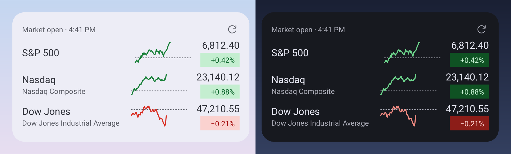
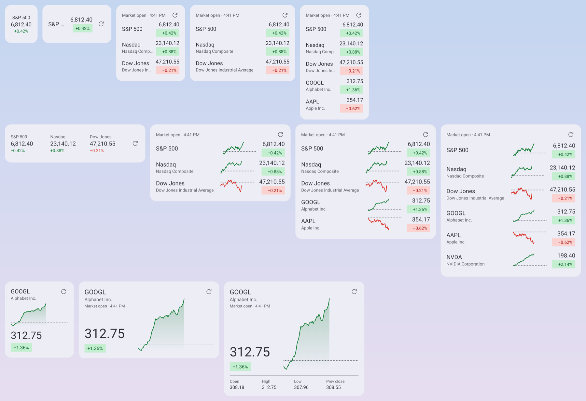
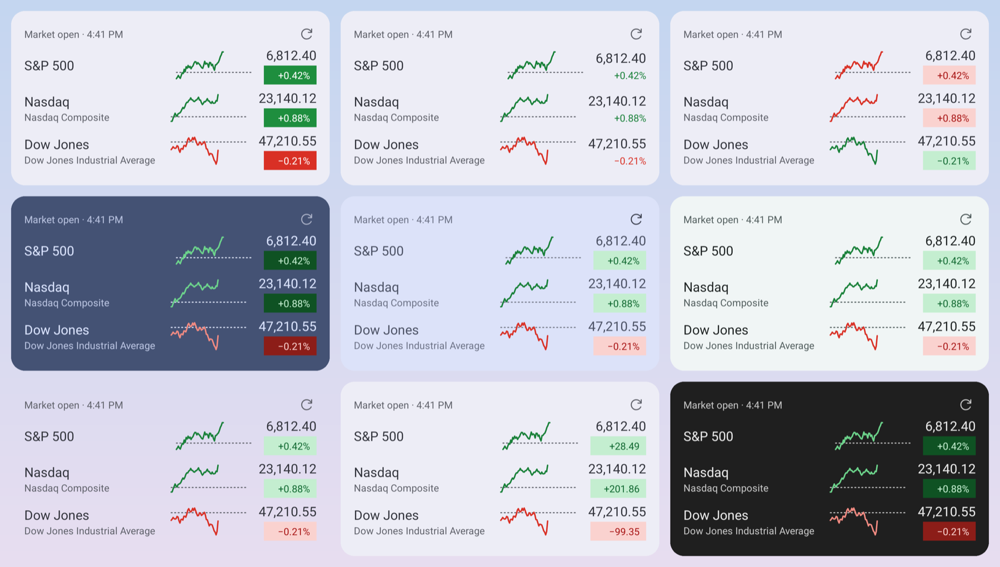

# Help Me Stocks

**The stocks widget Pixel should have shipped with.**

*Part of [Help Me Widgets](../README.md), together with [Help Me Weather](../help-me-weather/).*

iPhone has had a clean Stocks widget for years: your watchlist, the day's chart, price and a green or red change at a glance. Pixel has nothing like it. Help Me Stocks brings that layout to Pixel and builds it the Pixel way: Material 3, your wallpaper colors, and the same design and customization as its sibling, [Help Me Weather](../help-me-weather/), so the two widgets sit together on one home screen.

<p align="center">
  
</p>

> **It's just a widget.** Not a trading or finance app: no accounts, no ads, no analytics, no notifications (the permission is removed from the manifest), no location. Tapping a stock opens it in Yahoo Finance (as Apple's widget does) or Google.

## Download

**[⬇ Download Help Me Stocks 0.1.4 (APK)](https://github.com/artemulianko/help-me-widgets/releases/download/stocks-v0.1.4/help-me-stocks-0.1.4.apk)** · Android 12+ · 3.9 MB · [release notes](https://github.com/artemulianko/help-me-widgets/releases/tag/stocks-v0.1.4) · [all releases](https://github.com/artemulianko/help-me-widgets/releases)

SHA-256 `7747925554f9617bcccaf67acd1eae339bcfcf983b110130dbdd52b7ca10726d`

1. Download the APK on your phone and open it (allow "Install unknown apps" for your browser when asked).
2. Open **Help Me Stocks** once, and add or reorder stocks in **Watchlist**.
3. Long-press the home screen → **Widgets** → **Help Me Stocks** → drag it out. Long-press the widget → **Customize** to change it.

## Why it fits a Pixel

| | |
|---|---|
| **Your watchlist, one tap to add** | Search any stock, ETF, index, fund, currency or crypto on any exchange (New York, XETRA, London, Tokyo…) and add up to 20; reorder or remove in the app or right from the widget editor. One watchlist is shared by every widget. |
| **The day at a glance** | Price, change as a Material 3 tonal chip (or solid, or plain text), and the intraday chart with a dotted previous-close line. Like Apple's widget, a chart drawn mid-session stops part-way across. |
| **Matches your theme** | Material You colors come straight from the system's color resources, so the widget follows your wallpaper and light/dark mode immediately, even with a transparent background. Seven fixed palettes too. |
| **Same customization as Help Me Weather** | Palette, theme, background tone, opacity, what to show, and what a tap does: identical controls, live preview, every size. Gains in green or in red (East Asian convention). |
| **Material 3, by the guidelines** | Android's canonical widget specs: 16dp padding, system corner radius, 48dp touch targets, Google Sans on Pixel, and edge-to-edge fill at every size. |
| **Tap opens your finance app** | A stock opens in the Yahoo Finance app when installed (else the web page), or in Google's finance card. You can also make a tap open this app, refresh, or do nothing. |

## Every size, laid out properly

From 1×1 up to 4×4, plus landscape and foldables. Show your watchlist, or one stock large with its chart (and the day's open, high, low and previous close on bigger sizes). All sizes are pre-rendered, so resizing or rotating never wakes the app.

<p align="center"></p>

<p align="center"></p>

## Battery

Designed to be invisible in your battery stats, the same way Help Me Weather is.

| What | Cost |
|---|---|
| A refresh (every 30 min by default, **only while a market is open**) | One request for the whole watchlist, ~2 KB gzipped |
| Nights, weekends, between sessions | **No network at all**: closing prices are kept until the next session is due |
| Rendering the widget | ~100 ms, one-shot |
| Between refreshes | Nothing: no alarms, no services, no wakelocks, no listeners |

How:

- **Market-hours aware.** Every quote carries its exchange's session times, so the app knows when prices can't change: after the close it fetches once more for the final prices, then nothing until shortly before the next weekday session (holidays cost at most a few tiny checks). Works for any exchange, and 24-hour markets like crypto keep refreshing.
- **One batched request.** Yahoo's chart endpoint returns price, change and the intraday line for up to 20 symbols at once; the whole watchlist is one small download, shared by every widget.
- **WorkManager only.** Android batches refreshes with other apps' jobs, respects Doze and App Standby, waits for a network, and **skips background refreshes on low battery**. Manual refresh always works.
- **No Glance sessions.** Jetpack Glance normally keeps a background job (and a wakelock) alive for about 45 s after every widget update. Help Me Stocks renders straight to RemoteViews instead, so each update is a single short render.
- **Charts tinted, not redrawn.** The chart is drawn once as a white mask and tinted with theme colors, so light/dark switches don't need a new render.

## Privacy

- No accounts, analytics, crash reporting or ads. No location permission.
- Your watchlist and settings stay on the phone and are excluded from backups and device transfers.
- Network requests go only to Yahoo Finance (`query1`/`query2.finance.yahoo.com`): the symbols on your watchlist for quotes, and what you type into search. No identifiers are sent.
- The in-app **Logs** (last 3 days) stay on the phone.

## Data

Quotes come from Yahoo Finance's public chart endpoints, the data source behind Apple's Stocks widget. No key or sign-up needed. Prices may be delayed by up to 20 minutes depending on the exchange. These endpoints are unofficial; if Yahoo changes them, the widget keeps showing the last quotes and the error appears in the app. **Not investment advice.**

## Build from source

Requirements: JDK 21, Android SDK with platform 37, and an emulator or device running Android 12 or later.

```bash
./gradlew assembleDebug                 # debug APK
./gradlew assembleRelease               # minified release → releases/help-me-stocks-<version>.apk (needs keystore/; add -PallowDebugSigning=true for a local test build)
./gradlew testDebugUnitTest             # parsing, market-hours and formatting unit tests
./gradlew connectedDebugAndroidTest     # on-device: every widget size and configuration rendered
```

`WidgetRenderTest` renders the real widget at every size and in a matrix of configurations and saves PNGs to `/sdcard/Android/data/app.helpmestocks/files/renders` (run it with `adb shell am instrument` to keep them, since Gradle uninstalls the app afterwards).

To regenerate the icons (Material Symbols, converted with Android's own SVG converter), run `python3 tools/import_icons.py`. To regenerate the dynamic color resources, run `python3 tools/gen_colors.py`.

### Project layout

```
app/src/main/java/app/helpmestocks/
  data/     Yahoo Finance source, market hours, settings + quote cache (DataStore), formatting
  widget/   Glance layouts, sparkline, colors, session-free renderer, receivers
  work/     WorkManager refresh scheduling
  ui/       Compose (Material 3 Expressive) app, watchlist editor, per-widget editor
tools/      icon import, color generation, svg2vector
```

Built with Kotlin, Jetpack Glance, Compose Material 3, WorkManager and DataStore. No Retrofit, OkHttp or image libraries.

## Credits

- Market data from Yahoo Finance. Not affiliated with Yahoo, Apple or Google.
- [Material Symbols](https://fonts.google.com/icons) © Google, Apache License 2.0.
- Pixel and Google are trademarks of Google LLC.

## License

Code: [MIT](LICENSE). Third-party assets are under their own terms (see Credits).
